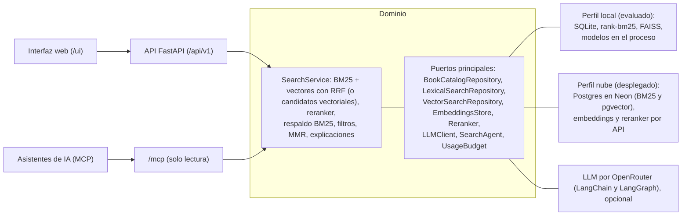
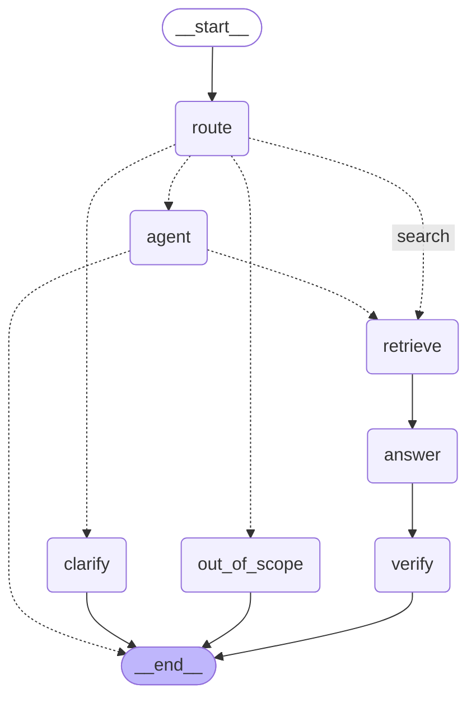

# Sistema inteligente de recomendación de libros mediante PLN y LLMs

Trabajo Fin de Grado de Luis Giménez (ETSINF, Universitat Politècnica de València).
Repositorio: https://github.com/luisgius/AI-Book-recommender

Es un buscador de libros que acepta peticiones en lenguaje natural y en varios
idiomas. Una búsqueda léxica (BM25) y una búsqueda semántica (embeddings
multilingües e índice vectorial) encuentran los candidatos, que se fusionan con
Reciprocal Rank Fusion, y un cross-encoder reordena los primeros; si la
búsqueda semántica no está disponible, responde BM25 sola. Los candidatos de la
búsqueda semántica sola, sin fusión, siguen disponibles como configuración
(`SEARCH_CANDIDATES=vector`): con consultas descriptivas puntuaron algo mejor,
pero con consultas por nombre de autor la fusión fue claramente mejor
([sección 5](#5-resultados-principales)).
Un LLM, opcional y siempre condicionado por los libros recuperados (RAG),
interpreta la consulta y explica con citas verificadas por qué cada libro
responde a ella. El código sigue una arquitectura hexagonal con dos perfiles de
adaptadores: uno local, que es el evaluado, y uno en la nube, que es el
desplegado.

Hay tres formas de comprobarlo, de menos a más esfuerzo:

| Nivel | Qué hace falta | Qué se comprueba |
|---|---|---|
| 1. [Sin instalar nada](#1-probarlo-sin-instalar-nada) | Un navegador | El sistema desplegado (perfil nube) |
| 2. [Un comando](#2-ejecutarlo-en-local-con-un-comando) | Python 3.11 a 3.13 y `make` | El perfil local evaluado, sin clave de API |
| 3. [Reproducir los resultados](#3-tests-y-reproducción-de-la-evaluación) | Lo mismo | Los tests y los informes de evaluación |

## 1. Probarlo sin instalar nada

**https://ai-book-recommender-one.vercel.app/ui/**

Es el perfil nube, con un catálogo de 50 000 obras de Wikidata y Wikipedia,
Project Gutenberg y DOAB
([`data/evaluation/DEPLOYMENT_CHECK.md`](data/evaluation/DEPLOYMENT_CHECK.md)).
Qué probar:

- Una petición temática en español: `novelas sobre la guerra civil española`.
- La misma idea en otro idioma: `romans policiers qui se déroulent à Paris`.
- Un título exacto: `Cien años de soledad`.
- Marcar «Explicar los primeros resultados (LLM)»: cada explicación cita campos
  del libro (descripción, categorías) que el sistema ha comprobado. Tarda unos
  segundos por libro.
- El botón «Libros similares» de un resultado (recomendación libro a libro).
- La API documentada en `/docs` y el estado del servicio en `/api/v1/health`.

Antes de una demostración conviene abrir la página un minuto antes: la primera
petición tras un periodo sin uso tardó 12.6 s y 22.3 s en las dos medidas de
arranque en frío. El despliegue tiene un presupuesto diario compartido por todos
los visitantes (400 búsquedas con modelos y 60 peticiones al LLM por día UTC);
agotado, la búsqueda sigue funcionando solo con BM25 y la página lo indica
(misma fuente).

## 2. Ejecutarlo en local con un comando

```
git clone https://github.com/luisgius/AI-Book-recommender.git
cd AI-Book-recommender
make demo
```

`make demo` crea un entorno virtual (`.venv`), instala `requirements.txt`,
construye los índices de la colección de evaluación de 177 libros
(`data/catalog.db`, incluida en el repositorio) y arranca el servidor en
**http://127.0.0.1:8000/ui/**. Ctrl+C lo detiene. No necesita clave de API ni
fichero `.env`, y arranca siempre con el LLM apagado, aunque el `.env` de la
máquina tenga una clave.

Configuración que arranca: los modelos locales evaluados, embeddings
`intfloat/multilingual-e5-large-instruct` y reordenación con
`BAAI/bge-reranker-v2-m3`, con los candidatos de BM25 (con normalización
léxica) y de la búsqueda vectorial fusionados con RRF, como en el despliegue.
Es el sistema `hybrid_norm_e5_bge_nopad` (0.660), empatado en esta colección
con la búsqueda vectorial sola (`vec_e5`, 0.661)
([`BM25_PADDING.md`](data/evaluation/BM25_PADDING.md)). `make demo
CANDIDATES=vector` arranca con los candidatos vectoriales solos y BM25 solo como
respaldo; en esta colección la combinación vectorial más reordenador no se
midió.

**Coste de la primera ejecución** (medido el 2026-11-12 en un portátil con Apple
M5 Pro, macOS y Python 3.13):

| Qué | Descarga | Notas |
|---|---|---|
| Paquetes de Python | unos 190 MB | `.venv` ocupa 1.1 GB instalado |
| `intfloat/multilingual-e5-large-instruct` | 1.14 GB | Caché de Hugging Face (`~/.cache/huggingface`) |
| `BAAI/bge-reranker-v2-m3` | 2.29 GB | Se puede omitir con `RERANKER=none` |

En total, unos 3.6 GB la primera vez; las ejecuciones siguientes reutilizan las
cachés de pip y de Hugging Face. Con las cachés llenas, `make demo` desde un
clon recién hecho tarda unos 60 s hasta arrancar el servidor (entorno virtual,
paquetes e índices); la primera búsqueda carga el reranker y tarda unos 5 s, y
las siguientes unos 2.3 s. Sin entorno ni índices que crear, el servidor
responde en menos de 10 s.

Opciones:

- `make demo RERANKER=none`: sin reordenación (sin la descarga de 2.29 GB y con
  búsquedas de menos de 0.1 s), pero sin la etapa que la evaluación respalda
  (ver la primera fila de la [tabla de resultados](#5-resultados-principales)).
- `make demo PORT=8001`: otro puerto, si el 8000 está ocupado.
- `make demo PYTHON=/ruta/a/python3.13`: si `make` no encuentra un Python entre
  3.11 y 3.13 (macOS trae un `python3` 3.9 que no sirve).
- `make demo LLM=on`: con el LLM de OpenRouter, usando `OPENROUTER_API_KEY` (y
  `LLM_MODEL`, si está) del entorno o del `.env`; para crearlo, copiar
  `.env.example` a `.env`, que describe todas las variables.

**Con el LLM apagado** (lo que tiene cualquier examinador sin clave) la búsqueda
funciona; la interpretación de la consulta, las explicaciones y el agente no
están disponibles, la interfaz desactiva esas opciones y la API devuelve el
aviso `llm_unavailable` (o un 503 con el motivo en `POST /api/v1/agent/ask`).
El asistente no falla: responde a cada mensaje con la búsqueda simple de su
texto y el mismo aviso. `make demo LLM=on` sin clave arranca igual, con el LLM
apagado.

`make help` lista los objetivos y `make clean` borra lo que `make` ha creado
(los índices de la demo y de la evaluación, y `.venv` si lo creó `make`).

## 3. Tests y reproducción de la evaluación

```
make test     # 1579 tests en unos 20 s (2026-11-12); 21 se omiten porque necesitan Postgres
make eval     # regenera los informes de data/evaluation/ sin llamar a ninguna API
git diff --stat data/evaluation/
```

`make eval` vuelve a calcular los informes a partir de los juicios de relevancia
y de las salidas de LLM guardadas en el repositorio: rehace las búsquedas con
los modelos locales y recalcula métricas, intervalos y tests. Tarda unos
10 minutos en el portátil de la medida y la primera vez descarga cinco
modelos locales (unos 5.2 GB; la lista se imprime al empezar). Después,
`git diff` muestra solo fechas, commit, tiempos medidos (latencias, carga de
modelos, construcción de índices) y el origen de los índices; las métricas no
cambian.

| Qué hace `make eval` | Informes de `data/evaluation/` |
|---|---|
| Rehace las búsquedas y recalcula | `COMPARISON_BASELINE.md`, `RETRIEVAL_ABLATION.md`, `RETRIEVAL_ABLATION_JUDGE_SENSITIVITY.md`, `LLM_RECOMMENDER.md`, `API_MODELS.md`, `BM25_PADDING.md`, `results_llm_path_k10.json`, `results_llm_path_k100.json` (resumidos a mano en `LLM_PATH_SUMMARY.md`) |
| Recalcula las tablas desde las medidas guardadas (necesitaron un servicio en vivo: Neon, el despliegue u OpenRouter) | `PROFILE_PARITY.md`, `CLOUD_LIVE_CHECK.md`, `LLM_MODEL_SELECTION.md` |
| No regenera | `DEPLOYMENT_CHECK.md`: necesita el despliegue. `JUDGE_AGREEMENT.md` y `COMPARISON_EXTENDED_QRELS.md`: necesitan el juez LLM. `EVALUATION_SUMMARY.md` y `QRELS_DATASHEET.md`: escritos a mano |

El informe de sensibilidad al juez compara los dos jueces sobre los 919 pares
que ambos calificaron para la ablación V06; los 146 juicios que V07 añadió
después al fichero del segundo juez quedan fuera de esa comparación (`--llm-
pairs-from`), y el fichero no se modifica.

La integración continua (`.github/workflows/tests.yml`) ejecuta `make test` en
cada push y pull request con Python 3.13.

## 4. Arquitectura

Arquitectura hexagonal (puertos y adaptadores). El dominio solo usa la
biblioteca estándar: no importa FastAPI, SQLite, FAISS ni LangChain (la única
referencia a la infraestructura es una anotación de tipos, `TYPE_CHECKING`, en
`app/domain/ports.py`).



| Capa | Dónde | Qué contiene |
|---|---|---|
| Dominio | `app/domain/` | Entidades, objetos valor, `SearchService` y los puertos (`ports.py`) |
| Infraestructura | `app/infrastructure/` | Adaptadores: `db/` (SQLite, Postgres), `search/` (BM25, FAISS, pgvector, rerankers, embeddings por API), `llm/` (cliente LangChain, prompts, asistente y agente LangGraph, juez), `external/` (fuentes del catálogo) |
| Aplicación | `app/api/`, `app/ui/`, `app/main.py` | API REST, servidor MCP, interfaz web y composición de adaptadores (`app/api/v1/dependencies.py`) |

Los dos perfiles comparten el mismo `SearchService`; `SEARCH_PROFILE` elige los
adaptadores y `SEARCH_CANDIDATES` de dónde salen los candidatos, en los dos:

- `hybrid` (por defecto): BM25 y la búsqueda vectorial se fusionan con RRF
  (k = 60, pesos iguales) antes del reranker.
- `vector`: la búsqueda vectorial da los candidatos, el reranker los ordena y
  BM25 no se consulta.

En los dos modos, si falla el embedding de la consulta o la búsqueda
vectorial, o se agota el presupuesto diario de búsquedas con modelos, responde
BM25 y la respuesta lo indica (`degraded`, `search_mode: "lexical_only"`). El
valor por defecto está en un solo sitio, `DEFAULT_CANDIDATES`
(`app/domain/value_objects.py`): lo usan el constructor de `SearchService` y
los ajustes de la aplicación cuando `SEARCH_CANDIDATES` no está definida. Los
módulos de evaluación construyen su propio `SearchService` con el modo de cada
informe escrito de forma explícita y no leen la variable, así que `make eval`
reproduce los informes publicados.

La respuesta de `/api/v1/search` dice en qué modo se buscó (`search_mode`:
`vector_only`, `hybrid` o `lexical_only`) y da el puesto de cada libro en cada
etapa que se ejecutó; en modo `vector` ningún resultado tiene puesto en BM25.
La página toma el modo de `/api/v1/health` (`profile.candidates`) para explicar
el pipeline que ejecuta el servidor.

En el perfil nube el embedding de la consulta se pide a DeepInfra y, si no ha
respondido en 1 s (o falla), también a Nebius; a los 2.5 s se repite la
petición a DeepInfra; gana la primera respuesta dentro de 5 s y las demás se
cancelan. La investigación de los fallos de V14
([`FINDINGS.md`](data/evaluation/catalog50k/investigation/FINDINGS.md),
pregunta 2) midió 0 fallos en 540 llamadas con esta estrategia frente a 3 con
DeepInfra sola, con la misma latencia mediana, y comprobó que los vectores de
consulta de Nebius sirven contra los documentos calculados con DeepInfra
(nDCG@10 0.689 frente a 0.682). Todas las peticiones de embeddings van
restringidas a endpoints sin retención de datos (`provider.zdr`), y los
vectores de las últimas 256 consultas se guardan en memoria por texto exacto:
la misma búsqueda repetida en la misma instancia devuelve la misma lista. Esa
caché no cubre una instancia nueva ni otra instancia en paralelo, donde el
orden de los diez primeros puede variar un poco (DeepInfra devuelve dos
variantes del vector para el mismo texto; la calidad medida es la misma).
`.env.example` documenta cada parámetro y cómo volver a la política anterior.

| | Perfil local (`SEARCH_PROFILE=local`) | Perfil nube (`SEARCH_PROFILE=cloud`) |
|---|---|---|
| Catálogo | SQLite, 177 libros (`data/catalog.db`) | Postgres en Neon, el catálogo desplegado |
| Léxica (respaldo; candidatos en modo `hybrid`) | rank-bm25 con normalización léxica | BM25 de Postgres (`lakebase_text`) |
| Vectorial | FAISS, `multilingual-e5-large-instruct` | pgvector, `qwen/qwen3-embedding-8b` por API |
| Reordenación | `BAAI/bge-reranker-v2-m3` en el proceso | `qwen/qwen3-reranker-8b` por API |
| Papel | Evaluado (44 consultas, juicios de relevancia) | Desplegado (URL pública); evaluado sobre su catálogo con jueces LLM (116 consultas) |

### El asistente conversacional

`POST /api/v1/assistant/chat` es la entrada conversacional del sistema y la que
usa el modo «Conversar con el asistente» de la interfaz. Un grafo LangGraph
(`app/infrastructure/llm/graphs/assistant.py`) lleva cada mensaje por uno de
cuatro caminos: `clarify` (una pregunta con dos a cuatro respuestas sugeridas,
como mucho dos por conversación), `search` (la búsqueda evaluada y una respuesta
que recomienda hasta tres libros con citas comprobadas), `agent` (el agente de
herramientas, para peticiones de varios pasos; si falla, pasa a la búsqueda) u
`out_of_scope` (respuesta fija). El servidor no guarda nada: el cliente envía la
conversación completa en cada petición y copia en cada turno del asistente la
`route` que recibió, que es como el servidor cuenta las preguntas ya hechas. La
respuesta incluye el camino, el tiempo de cada nodo, si el código corrigió la
ruta del modelo (`forced_route`), la consulta condensada, los filtros, los pasos
del agente y el uso del LLM. Sin LLM, o con el límite diario agotado, hace la
búsqueda simple del último mensaje y lo indica. `python -m
scripts.print_assistant_graph` imprime el grafo:



## 5. Resultados principales

### Sobre el catálogo desplegado (50 000 obras)

[`CATALOG_EVALUATION.md`](data/evaluation/CATALOG_EVALUATION.md), con el
protocolo declarado antes de ejecutarlo
([`2026-11-12-protocolo-evaluacion-catalogo.md`](docs/notes/2026-11-12-protocolo-evaluacion-catalogo.md)):
116 consultas en doce idiomas (estratos A y B) sobre el catálogo desplegado,
juicios de dos jueces LLM de familias distintas (aún sin acuerdo medido con
personas en este catálogo). nDCG@10 con el juez principal:

| Sistema | nDCG@10 [IC 95 %] |
|---|---|
| Solo BM25 | 0.336 [0.287, 0.384] |
| Solo vectorial (`qwen3-embedding-8b`) | 0.683 [0.647, 0.717] |
| Fusión híbrida RRF | 0.592 [0.554, 0.628] |
| Vectorial + reranker `qwen3-reranker-8b` (`SEARCH_CANDIDATES=vector`) | 0.798 [0.772, 0.823] |
| Híbrida + reranker (**configuración por defecto**) | 0.769 [0.740, 0.797] |

**Con consultas descriptivas, la fusión híbrida fue peor.** Sin reranker,
fusionar BM25 con la búsqueda vectorial bajó el nDCG@10 en -0.092
[-0.128, -0.055] (p de Holm < 0.001; con el segundo juez, -0.099). Con el
reranker, los candidatos de BM25 siguieron restando: -0.029 [-0.045, -0.014]
(p de Holm < 0.001; con el segundo juez, -0.035 [-0.054, -0.014]). El protocolo
había fijado de antemano que la configuración desplegada mantendría BM25 en la
fusión salvo que vectorial + reranker superase a híbrida + reranker de forma
significativa; se cumplió con los dos jueces, y durante un tiempo la
configuración por defecto fue vectorial + reranker. Ninguna de esas consultas
era solo un título o un nombre de autor, que es donde se espera que BM25 ayude;
la evaluación siguiente mide ese caso, y con las dos el autor eligió volver a la
fusión como configuración por defecto (`SEARCH_CANDIDATES`,
[sección 4](#4-arquitectura)). Los candidatos vectoriales solos siguen
disponibles con `SEARCH_CANDIDATES=vector`. El reordenador por LLM sobre la
fusión puntuó 0.811, pero añade unos 2.7 s y una llamada al LLM por búsqueda, y
no se desplegó.

### Búsqueda de un libro conocido por título y por autor

[`KNOWN_ITEM.md`](data/evaluation/known_item/KNOWN_ITEM.md), con su protocolo
guardado antes de ejecutar ningún sistema, aunque diseñado después de conocer
los resultados anteriores: 300 libros del catálogo desplegado (25 por idioma),
partidos en 150 de desarrollo y 150 de prueba, y de cada uno tres consultas
mecánicas: el título (T), el título con el primer autor (TA) y el nombre del
primer autor (A). La verdad de referencia sale del propio catálogo, sin jueces
LLM. Mitad de prueba, con el reranker en los dos lados:

| Consulta (métrica) | Vectorial + reranker | Híbrida + reranker | Diferencia [IC 95 %], p de Holm |
|---|---|---|---|
| T (MRR@10) | 0.979 | 0.980 | +0.001 [+0.000, +0.003], 1.000 |
| TA (MRR@10) | 0.997 | 0.997 | +0.000 [+0.000, +0.000], 1.000 |
| A (nDCG@10) | 0.894 | 0.960 | +0.067 [+0.033, +0.107], < 0.001 |

Con títulos la fusión no cambia nada; con nombres de autor los candidatos de
BM25 ayudan de forma significativa. Una repetición completa de la medida dio la
misma conclusión en los tres tipos de consulta
([`REPLICATION.md`](data/evaluation/known_item/replication/REPLICATION.md)).

### Sobre la colección de evaluación (177 libros)

nDCG@10 sobre la colección de 177 libros y 44 consultas (24 en inglés, 20 en
español). Diferencia con intervalo bootstrap del 95 % y p corregido por Holm
dentro de la familia de contrastes declarada en cada informe.

| Pregunta | Resultado | Informe |
|---|---|---|
| ¿Mejora el reranker `bge-reranker-v2-m3` el híbrido con e5? | Sí, de forma significativa: 0.668 frente a 0.570, +0.098 [+0.046, +0.155], p (Holm) 0.008. Con un segundo juez LLM de otra familia: +0.100 [+0.043, +0.160], p (Holm) 0.019 | [`RETRIEVAL_ABLATION.md`](data/evaluation/RETRIEVAL_ABLATION.md), [`RETRIEVAL_ABLATION_JUDGE_SENSITIVITY.md`](data/evaluation/RETRIEVAL_ABLATION_JUDGE_SENSITIVITY.md) |
| ¿Supera la fusión híbrida a la búsqueda solo vectorial? | No en esta colección: `hybrid_norm_e5` 0.570 frente a `vec_e5` 0.621 (descriptivo). Corregido el relleno de BM25: 0.622 frente a 0.661, -0.039 [-0.089, +0.010], p (Holm) 0.268 | [`RETRIEVAL_ABLATION.md`](data/evaluation/RETRIEVAL_ABLATION.md), [`BM25_PADDING.md`](data/evaluation/BM25_PADDING.md) |
| ¿Mejora e5 multilingüe a MiniLM en la parte vectorial? | Estimación positiva no significativa tras Holm: 0.621 frente a 0.523, +0.098 [+0.006, +0.187], p (Holm) 0.159 | [`RETRIEVAL_ABLATION.md`](data/evaluation/RETRIEVAL_ABLATION.md) |
| ¿Mejora el LLM como recomendador (reordena los 30 primeros) al pipeline? | No confirmado: en la primera ejecución 0.745 frente a 0.688, +0.057 [+0.007, +0.103], p (Holm) 0.047; en la segunda ejecución del mismo sistema, +0.037 [-0.022, +0.090], p sin corregir 0.203 | [`LLM_RECOMMENDER.md`](data/evaluation/LLM_RECOMMENDER.md) |
| ¿Da Postgres los mismos resultados que el perfil local con los mismos vectores? | Sin diferencias significativas: vectorial exacta +0.000; léxica +0.003 [-0.032, +0.039], p (Holm) 1.000; híbrida +0.032 [-0.007, +0.074], p (Holm) 0.417 | [`PROFILE_PARITY.md`](data/evaluation/PROFILE_PARITY.md) |
| ¿Pierden calidad los modelos por API del perfil nube? | No en esta colección. Embeddings `qwen3-embedding-8b`: 0.654 frente a 0.655 de e5, -0.001 [-0.061, +0.059], p (Holm) 1.000. Reranker `qwen3-reranker-8b`: 0.758 frente a 0.681 de bge, +0.076 [+0.023, +0.133], p (Holm) 0.044 | [`API_MODELS.md`](data/evaluation/API_MODELS.md) |

Los valores de nDCG@10 de filas distintas no son comparables entre sí: cada
informe usa su versión de los juicios (los juicios añadidos por el juez LLM
cambian el nDCG ideal de algunas consultas).

## 6. Límites conocidos

- **Dos evaluaciones con alcances distintos.** La colección de 177 libros tiene
  juicios originales más juicios de un juez LLM; el catálogo desplegado de
  50 000 obras (`CATALOG_EVALUATION.md`) solo tiene juicios de jueces LLM, y la
  hoja de anotación humana de 200 pares está sin rellenar. La configuración
  por defecto (híbrida + reranker) se eligió con esa evaluación y con la de
  búsqueda de un libro conocido (`KNOWN_ITEM.md`), que sí tiene verdad de
  referencia exacta; en la colección de 177 libros quedó empatada con la
  búsqueda vectorial sola, y vectorial + reranker no se midió allí.
- **La configuración por defecto es un compromiso.** La fusión pierde 0.029 de
  nDCG@10 con consultas descriptivas (jueces LLM) y gana 0.067 con consultas
  por nombre de autor; no se sabe con qué frecuencia busca la gente de cada
  forma.
- **Colección pequeña.** 44 consultas y 177 libros: diferencias de nDCG@10
  menores de unos 0.08 son difíciles de detectar, y los resultados pueden no
  trasladarse a un catálogo mayor (`RETRIEVAL_ABLATION.md`).
- **Juicios del LLM.** Parte de los juicios de relevancia los puso un juez LLM,
  no personas. Con solo los juicios originales, la mejora del reranker es
  +0.043 [-0.026, +0.111] y no es significativa (`RETRIEVAL_ABLATION.md`).
- **Límites del despliegue** (`DEPLOYMENT_CHECK.md`, sección «Protections» y
  final): el presupuesto diario es compartido por todos los visitantes; los
  límites por cliente se cuentan en la memoria de cada instancia y no son un
  techo garantizado; un proveedor lento puede costar hasta unos 5 s por llamada
  antes de degradar la búsqueda (vectorial perdida: solo léxica; reranker
  perdido: orden de los candidatos); la estrategia con un segundo proveedor de
  embeddings reduce esos fallos pero no cubre un episodio que afecte a los dos
  proveedores a la vez ni una caída de OpenRouter; las explicaciones tardan (tres explicaciones, 23.5 s
  en la medida); la primera petición tras un periodo sin uso tardó 12.6 s y
  22.3 s; las consultas sin respuesta buena en el catálogo devuelven igualmente
  diez resultados, sin relación con la consulta.
- **La configuración local por defecto del código no es la evaluada.** Sin
  variables, el código usa el índice de `data/indexes` (`all-MiniLM-L6-v2`, sin
  reranker); `make demo` fija los modelos evaluados y el `Dockerfile` usa la
  configuración ligera.

## 7. Servidor MCP

El despliegue publica un servidor MCP de solo lectura en `/mcp` con tres
herramientas: `search_books`, `get_book` y `similar_books`. No llama al LLM ni
necesita autenticación. Para usarlo desde Claude Code:

```
claude mcp add --transport http book-recommender https://ai-book-recommender-one.vercel.app/mcp
```

Con `make demo` también está disponible en local en http://127.0.0.1:8000/mcp.
`python -m scripts.mcp_demo --url <url>/mcp` lo recorre desde la línea de
comandos. Detalles en
[`docs/notes/tareas/V15-servidor-mcp.md`](docs/notes/tareas/V15-servidor-mcp.md).

## 8. Mapa del repositorio

| Ruta | Contenido |
|---|---|
| `app/domain/` | Núcleo: entidades, `SearchService`, puertos |
| `app/infrastructure/` | Adaptadores (bases de datos, búsqueda, LLM, fuentes externas) y configuración (`config/settings.py`) |
| `app/api/` | API REST (`v1/`) y servidor MCP (`mcp/`) |
| `app/ui/static/` | Interfaz web (HTML y JavaScript sin dependencias) |
| `app/ingestion/` | Construcción del catálogo multifuente |
| `app/evaluation/` | Experimentos, métricas, juicios de relevancia (`relevance_judgments*.json`) y consultas de prueba (`test_queries.json`) |
| `data/catalog.db`, `data/indexes/` | Colección de evaluación de 177 libros e índices ligeros incluidos |
| `data/evaluation/` | Informes (`*.md`), resultados (`results_*.json`) y cachés de juicios y salidas de LLM |
| `scripts/` | Ingesta, construcción y carga del catálogo en Postgres, comprobación del despliegue, cliente MCP |
| `tests/` | Tests de pytest (dominio, API, infraestructura, evaluación, integración) |
| `docs/notes/` | Notas de validación y de cada tarea; `docs/arch_decisions/` decisiones de arquitectura |
| `Makefile`, `.env.example`, `Dockerfile` | Ejecución local, variables de entorno, contenedor del perfil local ligero |
| `pyproject.toml`, `vercel.json`, `requirements-cloud.txt` | Despliegue del perfil nube en Vercel |

## 9. Notas de las tareas

El razonamiento general está en
[`docs/notes/2026-11-11-validacion-proyecto-2026.md`](docs/notes/2026-11-11-validacion-proyecto-2026.md)
y [`docs/notes/2026-11-11-propuesta-nube-y-mcp.md`](docs/notes/2026-11-11-propuesta-nube-y-mcp.md);
el estado de cada tarea, en
[`docs/notes/tareas/README.md`](docs/notes/tareas/README.md). Cada nota explica qué
se hizo, por qué, qué se descartó y cómo se validó.

| Tarea | Nota |
|---|---|
| V01 | [Normalización léxica para BM25](docs/notes/tareas/V01-normalizacion-lexica.md) |
| V02 | [Embeddings configurables y control modelo-índice](docs/notes/tareas/V02-embeddings-configurables.md) |
| V03 | [Higiene de evaluación](docs/notes/tareas/V03-higiene-evaluacion.md) |
| V04 | [Puerto `Reranker` y cross-encoder](docs/notes/tareas/V04-reranker.md) |
| V05 | [Juez LLM de relevancia](docs/notes/tareas/V05-juez-llm-relevancia.md) |
| V06 | [Ablación de la recuperación](docs/notes/tareas/V06-ablacion-recuperacion.md) |
| V07 | [El LLM como recomendador](docs/notes/tareas/V07-llm-como-recomendador.md) |
| V08 | [OpenRouter y coste por llamada](docs/notes/tareas/V08-openrouter-y-coste.md) |
| V10 | [Selección de los modelos LLM](docs/notes/tareas/V10-seleccion-modelos-llm.md) |
| V11 | [Catálogo multilingüe de varias fuentes](docs/notes/tareas/V11-catalogo-multifuente.md) |
| V12 | [Perfil nube en Postgres y paridad](docs/notes/tareas/V12-perfil-nube-postgres.md) |
| V13 | [Integración del perfil nube y relleno de BM25](docs/notes/tareas/V13-integracion-nube-y-relleno-bm25.md) |
| V15 | [Servidor MCP de solo lectura](docs/notes/tareas/V15-servidor-mcp.md) |
| V16 | [Modelos por API y selección por velocidad y calidad](docs/notes/tareas/V16-modelos-por-api.md) |
| V17 | [Despliegue público](docs/notes/tareas/V17-despliegue-publico.md) |

## 10. Fuentes de datos y licencias

- **Colección de evaluación** (`data/catalog.db`, 177 libros): metadatos y
  descripciones obtenidos de la API de Google Books en 2024
  ([`V11`](docs/notes/tareas/V11-catalogo-multifuente.md)). Las condiciones de
  Google Books prohíben construir una base de datos permanente con sus datos;
  por eso Google Books no es la base del catálogo desplegado (V11).
- **Catálogo desplegado** (V11 y `DEPLOYMENT_CHECK.md`):

| Fuente | Licencia | Atribución |
|---|---|---|
| Wikidata | CC0 1.0 | No necesaria |
| Texto de Wikipedia | CC BY-SA 3.0 (vía DBpedia) o 4.0 (API) | URL del artículo en cada registro, visible bajo cada resultado con enlace a la licencia |
| Project Gutenberg (catálogo) | Sin licencia explícita para los metadatos | Enlace al libro |
| DOAB (Directory of Open Access Books) | Metadatos CC0 1.0 | Enlace a su página en DOAB |

- **Modelos**: `intfloat/multilingual-e5-large-instruct` (licencia MIT, V06),
  `BAAI/bge-reranker-v2-m3` y `all-MiniLM-L6-v2`, descargados de Hugging Face;
  el perfil nube usa modelos por la API de OpenRouter.

## 11. Coste del despliegue público

Coste fijo cero: el backend corre en el plan Hobby de Vercel y la base de datos
en el plan gratuito de Neon
([`V17`](docs/notes/tareas/V17-despliegue-publico.md)). El único gasto variable
son las llamadas a modelos por OpenRouter: calcular los embeddings del catálogo
costó 0.0560 USD para las primeras 30 000 obras y 0.0350 USD para las 20 000
añadidas después (`DEPLOYMENT_CHECK.md`, secciones «Footprint and sizes» y
«Enlargement to 50,000 works»), y con los límites diarios de producción el peor caso es de unos
0.72 USD al día (400 búsquedas por unos 0.0015 USD más 60 peticiones al LLM por
unos 0.002 USD como máximo; `DEPLOYMENT_CHECK.md`, sección «Protections»).
