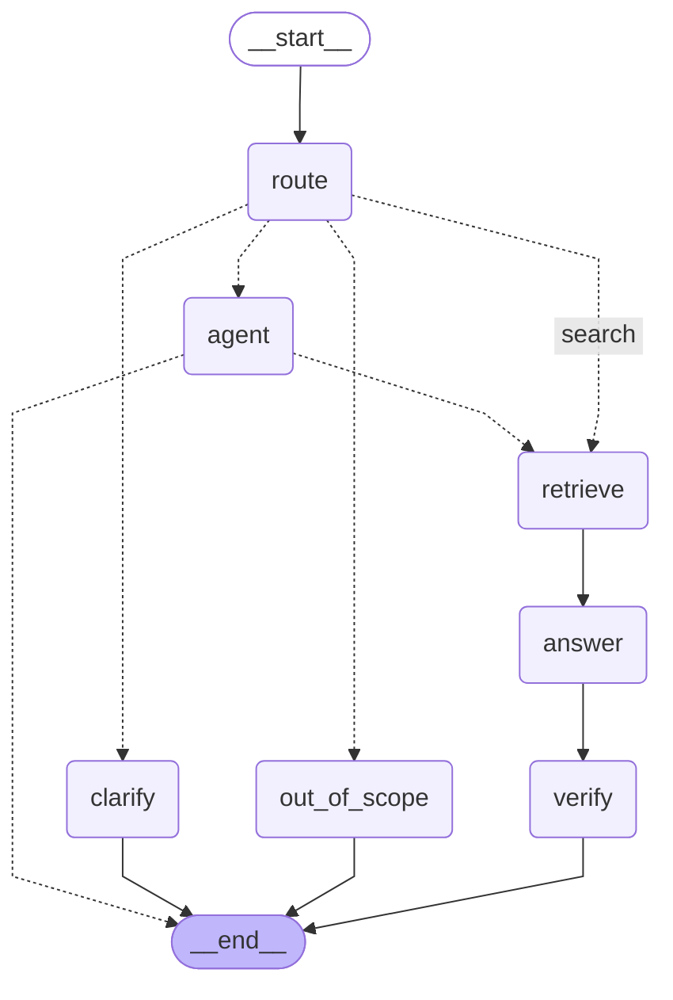

# V20 · Asistente conversacional con LangGraph como punto de entrada, y explicaciones en paralelo

- **Fecha:** 2026-11-12 (commits `f3003f8`, `0e0c571`, `5a4cfa2` y `d45ceaa`)
- **Estado:** hecha y probada con tests y con una comprobación en vivo; la calidad del asistente no se ha medido
- **Capa:** dominio (`app/domain/`), infraestructura (`app/infrastructure/llm/`), aplicación (`app/api/v1/`), scripts

## Qué se ha hecho

- Un asistente conversacional que es la puerta de entrada de las peticiones que usan un LLM (modelo de lenguaje grande). Es un grafo de LangGraph (biblioteca que describe un flujo como nodos y aristas sobre un estado compartido) que lee una conversación corta y elige una de cuatro rutas: hacer una pregunta aclaratoria, buscar y recomendar, pasar la petición al agente que ya existía, o declarar que la petición no es de libros. Vive detrás de un puerto nuevo del dominio, `ConversationalAssistant`, y su implementación es `LangGraphAssistant` (`app/infrastructure/llm/graphs/assistant.py`).
- Un endpoint nuevo, `POST /api/v1/assistant/chat`, conectado en los perfiles local y nube. Sin LLM o con el presupuesto diario de LLM agotado no falla: hace una búsqueda simple del último mensaje y lo dice en `notices`, como ya hace `/search`. `/search` y `/agent/ask` no cambian.
- Las explicaciones de una lista de resultados se generan ahora en paralelo (`SearchService._add_explanations`), en lugar de una llamada al LLM detrás de otra.
- `scripts/print_assistant_graph.py` imprime el grafo en formato Mermaid sin modelo ni red.

## Por qué

El 2026-11-12 el autor preguntó por qué el agente no aparecía en la página web. Respondió: "langgraphg is our system we can enorute it a system". El diseñador lo leyó como que LangGraph debe ser el punto de entrada que enruta cada petición; esa lectura es del diseñador, no una cita literal de lo que quería el autor. Sobre la memoria de la conversación, el autor contestó: "Okay but chat can make follow up questions before deciding a book". Y sobre las explicaciones más rápidas: "lets go for it and test it".

La nota de validación del 2026-11-11 (`docs/notes/2026-11-11-validacion-proyecto-2026.md`, sección 4) había rechazado convertir el proyecto en un recomendador conversacional agéntico, porque cambiaba el objeto de estudio y dejaba el agente como extensión. Esta tarea no revierte ese veredicto, lo acota. Se admite una aclaración corta antes de recomendar (hasta dos preguntas) y se mantiene fuera el chat abierto y cualquier memoria de largo plazo. El sistema principal sigue siendo la búsqueda evaluada: la ruta de búsqueda ejecuta siempre el mismo `SearchService` que se midió en las tareas anteriores.

## Objetivo

1. Que una sola entrada decida qué hacer con cada petición, sin que el cliente tenga que elegir entre `/search` y `/agent/ask`.
2. Que el asistente pueda preguntar antes de buscar cuando la petición es demasiado vaga, sin convertirse en un chat sin límite.
3. Que todo lo que recomienda salga de libros recuperados del catálogo y con citas comprobadas.
4. Reducir la espera de las explicaciones de una lista de resultados.

## Diseño

### El grafo

Un único `StateGraph` con siete nodos. Esta es su descripción en Mermaid, tal como la imprime `python -m scripts.print_assistant_graph` (la genera LangGraph a partir del grafo, sin modelo ni red).



### Nodo por nodo

- **route.** Una llamada al LLM con salida estructurada estricta (el modelo debe devolver un objeto con campos fijos, `RouteDecisionLLM`). Devuelve la ruta, la consulta condensada de toda la conversación, los filtros que el usuario pidió y, si hay que aclarar, una pregunta con 2 a 4 opciones. Ese resultado no se usa tal cual: pasa por código ordinario, `apply_routing_rules`, que aplica las reglas. Si no hay agente configurado, una petición de ruta `agent` se trata como búsqueda.
- **clarify.** Devuelve la pregunta y sus opciones. No se busca nada.
- **retrieve.** Ejecuta siempre el pipeline evaluado (`SearchService.search_with_fallback`) sobre la consulta condensada y los filtros. Es un nodo fijo, no una herramienta que el modelo pueda saltarse.
- **answer.** Una llamada al LLM que recomienda hasta 3 de los 6 primeros resultados, cada una con una razón y citas literales de los campos del libro (título, autores, descripción o categorías). Cada descripción se corta a 600 caracteres.
- **verify.** Descarta las recomendaciones que no están entre los libros mostrados y pasa cada cita por el filtro de citas que ya usan las explicaciones (`guardrails.filter_valid_citations`: el fragmento debe ser una subcadena del campo citado, ignorando mayúsculas y espacios). Una recomendación sin ninguna cita válida se descarta. Si no sobrevive ninguna, se muestra un mensaje fijo junto a los resultados. Si la búsqueda no devolvió nada, otro mensaje fijo, y no se hace la llamada de `answer`.
- **agent.** Entrega la petición condensada al agente con herramientas que ya existía. Si falla, la ruta pasa a búsqueda (arista de `agent` a `retrieve`) y se añade el aviso `agent_failed`.
- **out_of_scope.** Una respuesta fija. No hay búsqueda ni más llamadas al LLM.

### Por qué la recuperación es un nodo fijo

Si el modelo decidiera si buscar o no, podría contestar desde su memoria, y la medición de V07 mostró que sin catálogo ninguna de sus 440 recomendaciones estaba en el catálogo. Con un nodo fijo, todo lo que el asistente recomienda procede de la búsqueda evaluada y el modelo solo puede elegir entre los libros mostrados. Además, la búsqueda sigue siendo el componente medido del proyecto.

### Por qué el servidor no guarda estado

El cliente envía la conversación completa en cada petición y el servidor no escribe nada: no hay checkpointer (mecanismo de LangGraph que guarda el estado entre llamadas). Así el asistente no necesita almacenamiento nuevo, funciona igual en la función serverless del perfil nube y no conserva datos de nadie. El precio es que un servidor sin estado no sabe qué turnos anteriores eran preguntas. Por eso el cliente devuelve el campo `route` en los turnos del asistente. Un turno del asistente sin `route` cuenta como pregunta, de modo que un cliente que lo omita recibe menos preguntas, nunca más.

### Reglas que se aplican en código

- Como máximo 2 preguntas aclaratorias por conversación, contadas sobre todo lo que envió el cliente antes de recortar (así, quitar turnos antiguos no reabre el cupo).
- Si la llamada de enrutado lanza una excepción o devuelve un tipo inesperado, la petición se convierte en una búsqueda del último mensaje del usuario.
- Una aclaración sin pregunta, o con menos de 2 opciones, se convierte en búsqueda.
- Los filtros de idioma y de año solo se aplican si las propias palabras del usuario los expresan (se reutilizan las reglas de `filter_guards.py`; años plausibles entre 1000 y 2100 y en orden).
- Tras una pregunta, `out_of_scope` solo se mantiene si el modelo etiqueta el último mensaje como `unrelated`.

Están en código y no en el prompt porque un prompt es una petición y no una garantía: un modelo puede ignorarla o interpretarla mal, y estas reglas son las que acotan coste y comportamiento. En código se prueban con tests deterministas y no dependen del modelo.

### Límites

| Límite | Valor |
|---|---|
| Mensajes de la conversación que se leen | 10 (los más recientes) |
| Caracteres por mensaje | 500 |
| Turnos aclaratorios | 2 |
| Máximo de la API (422 si se supera) | 50 mensajes y 5000 caracteres por mensaje |
| Tokens de salida de la llamada de enrutado | 400 |
| Recomendaciones y libros que ve `answer` | hasta 3 de los 6 primeros |

### Seguridad frente a texto de fuentes editables

Los títulos y descripciones proceden de fuentes que cualquiera puede editar (por ejemplo Wikipedia). El texto de los libros solo llega al prompt de `answer`, dentro de un bloque declarado como datos externos; el enrutador solo ve la conversación, que también se declara como datos. Un test comprueba que un texto plantado en una descripción no llega al enrutador. Aunque `answer` obedeciera una instrucción plantada, solo podría recomendar libros mostrados y con citas literales verificadas por código. La resistencia con el modelo real no se ha probado (véanse los límites).

### Trazabilidad

Cada llamada al LLM se registra con su nodo, y la respuesta incluye los tiempos por nodo (`timings_ms`) y el uso de la petición (llamadas, llamadas fallidas, tokens y coste informado). Cada petición cuenta contra el límite de peticiones LLM por cliente y consume una unidad del presupuesto diario de LLM, sea cual sea la ruta.

## Dónde la construcción se apartó del diseño inicial, y qué se aprendió

1. **Contar las aclaraciones necesita la ayuda del cliente.** Un servidor sin estado no puede saber qué turnos previos fueron preguntas; de ahí el eco del campo `route`.
2. **La ruta de búsqueda da una respuesta que recomienda hasta 3 libros**, no una explicación por resultado. Esa ruta cuesta 2 llamadas al LLM (enrutado y respuesta).
3. **Decidir si la respuesta a una pregunta está fuera de alcance necesitó una etiqueta del modelo.** Una primera regla que dependía de que el modelo rellenara la consulta de búsqueda mandó "no sé, lo que sea" a fuera de alcance; un indicador de sí o no también falló. Ahora el modelo etiqueta el último mensaje como `answer`, `non_answer` o `unrelated`, y el código mantiene `out_of_scope` tras una pregunta solo para `unrelated`. En vivo: "no sé" tras dos preguntas buscó en 4 de 4 ejecuciones, y "olvídalo, ¿qué hora es en Tokio?" siguió fuera de alcance en 2 de 2.
4. **El primer esquema hacía que el modelo entrara en bucle.** Con campos que admitían nulo y `reason` como último campo, la llamada de enrutado emitió espacios en blanco hasta el tope de tokens en 2 de 9 llamadas en vivo (4 de 10 contando una ejecución posterior de depuración). Ahora el esquema usa cadena vacía y 0 para "no indicado", escribe `reason` primero, y la llamada tiene su propio tope de 400 tokens; ninguna de las 25 llamadas de enrutado posteriores al cambio falló. Es una observación sobre pocas llamadas, no una causa demostrada.
5. **Las respuestas fijas existen solo en español e inglés**; otros idiomas reciben el texto en inglés. El texto que escribe el LLM sigue el idioma del usuario.
6. **El agente recibe solo la petición condensada**, no todo el historial.
7. **Cuando el tope fuerza una búsqueda**, la consulta es todo lo que el usuario escribió, ruido incluido (por ejemplo "un libro algo no sé").

## Explicaciones en paralelo

Antes, `SearchService._add_explanations` llamaba al LLM una vez por resultado, una tras otra, para los primeros resultados (3 por defecto). Ahora las llamadas se ejecutan en un grupo de hilos limitado por `explanation_workers` (3 por defecto; con 1 se recupera el comportamiento anterior). Se mantiene el orden, una llamada fallida solo deja sin explicación a su propio resultado, y la petición sigue consumiendo una unidad de presupuesto de LLM. El parámetro se fija al construir `SearchService`; no hay variable de entorno asociada.

Medición: modelo `deepseek/deepseek-v4.1-flash`, perfil local, 3 primeros resultados de 2 consultas, 3 repeticiones cada una (n = 6 por lado), con los mismos libros en ambos lados. Son pocas ejecuciones en un portátil.

| | media | mediana | mínimo | máximo |
|---|---|---|---|---|
| secuencial (antes) | 8.95 s | 10.09 s | 4.96 s | 11.43 s |
| concurrente (después) | 4.78 s | 3.72 s | 2.62 s | 11.05 s |

La ejecución de 11.05 s hizo 4 llamadas en lugar de 3 (un reintento). No se añadió streaming (respuesta enviada por partes): exigiría un endpoint de eventos enviados por el servidor y llamadas en modo streaming, y la comprobación de citas solo puede ejecutarse sobre una explicación terminada.

## Alternativas consideradas y por qué no

| Alternativa | Por qué no |
|---|---|
| Checkpointer con conversaciones guardadas en el servidor | Añadiría almacenamiento y datos de usuarios que el proyecto no necesita; el cliente puede reenviar un historial de 10 mensajes. Contradice además el rechazo de la memoria de largo plazo de la nota de validación |
| Dejar que el modelo decida si busca | Podría responder sin catálogo; V07 midió que entonces ningún libro recomendado estaba en el catálogo |
| Una explicación por resultado en la ruta de búsqueda | Más llamadas por petición; una respuesta que recomienda hasta 3 libros cuesta 2 llamadas en total |
| Poner las reglas (tope de preguntas, filtros) solo en el prompt | No son verificables ni acotan el coste; en código se comprueban con tests |
| Streaming de la respuesta | Exige un endpoint de eventos enviados por el servidor, y las citas solo se pueden comprobar sobre una explicación terminada |
| Responder 429 cuando se agota el presupuesto de LLM | El endpoint de búsqueda ya degrada a búsqueda simple con un aviso; se mantiene el mismo comportamiento. El 429 queda para el límite de peticiones por cliente |
| Pasar el historial completo al agente | El agente recibe la petición ya condensada (diferencia 6); no se probó otra cosa |

## Cómo se ha validado

- Tests: 1674 superados y 22 omitidos en la rama de la tarea; 1716 superados y 22 omitidos tras unirla a los cambios de la página web del mismo día. El test de arquitectura pasa. No se añadió ninguna dependencia.
- Tests del asistente (`tests/infrastructure/llm/test_assistant_graph.py`): las cuatro rutas, el tope de preguntas (también con turnos que el recorte elimina), los turnos sin ruta, las tres etiquetas del último mensaje, salida de enrutado inválida o fallida, aclaración sin dos opciones, filtros solo si el usuario los expresó, fallo del agente y de la respuesta, respuesta sin recomendaciones verificadas, y que el texto de un libro solo llega al prompt de `answer`. Otros: `tests/domain/test_conversation_bounds.py`, `tests/domain/test_concurrent_explanations.py` (orden, tope de hilos, un fallo aislado, un hilo, una unidad de presupuesto) y `tests/api/test_assistant_api.py` (contrato, degradación sin LLM y con presupuesto agotado, límite de peticiones, peticiones inválidas, endpoints existentes sin cambios).
- Comprobación en vivo, que no es una evaluación: perfil local, 177 libros, reranker en CPU; los 10 turnos devolvieron HTTP 200.

| Conversación | Turno | Ruta | Tiempos por nodo (ms) | Coste USD |
|---|---|---|---|---|
| "Busco libros sobre la novela histórica española" | 1 | search | route 1619, retrieve 4043, answer 3651 | 0.000652 |
| "Books to learn Python programming for beginners" | 1 | search | route 1337, retrieve 2334, answer 2164 | 0.000574 |
| "novela" | 1 | clarify (4 opciones) | route 1854 | 0.000170 |
| respuesta "Novela negra o policiaca" | 2 | search; 0 recomendaciones verificadas (no hay novela negra en esta colección); mensaje fijo | route 712, retrieve 2386, answer 1418 | 0.000294 |
| "Compara 'Core Python Programming' y 'Python Crash Course'..." | 1 | agent, 4 llamadas a herramientas | route 686, agent 15738 | 0.002410 |
| "¿Qué tiempo hará mañana en Valencia?" | 1 | out_of_scope | route 901 | 0.000125 |
| "un libro" | 1 | clarify | route 1837 | 0.000123 |
| "algo" | 2 | search | route 892, retrieve 2389, answer 2731 | 0.000892 |
| "no sé" | 3 | search | route 1513, retrieve 2355, answer 1716 | 0.000586 |
| dos preguntas previas en el historial, luego "no sé" | 1 | search (forzada por el tope de aclaraciones) | route 698, retrieve 2281, answer 2819 | 0.001659 |

Total de esa ejecución: 0.0075 USD; todo el trabajo en vivo de la tarea, menos de 0.07 USD. Casi todo el tiempo de `retrieve` es el reranker en CPU. El intento natural nunca produjo una segunda pregunta, así que el tope solo se ejercitó con un historial aportado por el cliente.

## Límites que debe conocer el tribunal

- No se ha verificado el perfil nube ni la base de datos Neon en vivo, ni las explicaciones concurrentes en el despliegue serverless.
- No se ha verificado la resistencia a instrucciones inyectadas con el modelo real; solo se prueba con texto plantado en tests unitarios.
- No se han probado idiomas distintos del español y el inglés.
- La calidad del asistente no se ha medido: no se sabe si preguntar mejora los resultados, si reconoce bien lo que está fuera de alcance, ni si lo que recomienda es más relevante que el pipeline simple. Esta tarea no afirma que el asistente mejore las recomendaciones.
- Las medidas son pocas ejecuciones en un portátil: 6 por lado en las explicaciones, 10 turnos en la comprobación en vivo, y las cifras de 4 de 4, 2 de 2 y 25 llamadas sin fallo son recuentos pequeños. Una ejecución de las explicaciones concurrentes tardó 11.05 s, casi lo mismo que el máximo secuencial.
- La consulta de una búsqueda forzada por el tope incluye todo lo que escribió el usuario, ruido incluido.

## Trabajo pendiente

- Evaluar la calidad del asistente con un protocolo declarado de antemano (si preguntar mejora los resultados, si reconoce lo que está fuera de alcance, relevancia de lo recomendado frente al pipeline simple).
- Conectar la página web al asistente, que se construye el mismo día.
- Probar el asistente en el perfil nube y las explicaciones concurrentes en el despliegue serverless.

## Cómo reproducirlo

```
python -m scripts.print_assistant_graph      # grafo en Mermaid; sin modelo ni red

uvicorn app.main:app --port 8000
curl -s -X POST http://127.0.0.1:8000/api/v1/assistant/chat \
  -H 'Content-Type: application/json' \
  -d '{"messages": [
        {"role": "user", "content": "novela"},
        {"role": "assistant", "content": "¿Qué tipo de novela?", "route": "clarify"},
        {"role": "user", "content": "Novela negra o policiaca"}
      ], "max_results": 5}'

pytest tests/infrastructure/llm/test_assistant_graph.py tests/api/test_assistant_api.py \
       tests/domain/test_conversation_bounds.py tests/domain/test_concurrent_explanations.py
```

La conversación debe terminar en un mensaje del usuario (si no, 400). Con un LLM configurado (clave de OpenRouter en el entorno, nunca versionada), el asistente responde con la ruta elegida; sin LLM, la respuesta es la búsqueda simple con el aviso `llm_unavailable`.

## Ficheros

- Dominio: `app/domain/value_objects.py` (`ChatMessage`, `bound_conversation`, `count_clarifications`, constantes de rutas y límites), `app/domain/entities.py` (`AssistantReply`, `AssistantRecommendation`), `app/domain/ports.py` (`ConversationalAssistant`), `app/domain/services.py` (explicaciones en paralelo y respuesta de búsqueda simple).
- Infraestructura: `app/infrastructure/llm/graphs/assistant.py`, `prompts_assistant.py`, `schemas_assistant.py`.
- Aplicación: `app/api/v1/assistant_endpoints.py`, `schemas.py`, `converters.py`, `dependencies.py`, `app/main.py`.
- Scripts: `scripts/print_assistant_graph.py`.
- Tests: `tests/infrastructure/llm/test_assistant_graph.py`, `tests/api/test_assistant_api.py`, `tests/domain/test_conversation_bounds.py`, `tests/domain/test_concurrent_explanations.py`.
